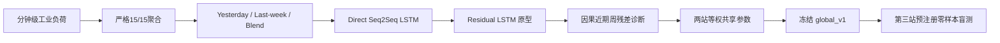

# industrial-load-forecasting

## 工业负荷预测：跨电站因果预测与零样本验证

一个面向工业储能场景的15分钟滚动负荷预测项目。每次使用过去7天数据，直接预测未来24小时共96个负荷点；预测每15分钟更新一次，但不需要重新训练。

项目从 Seq2Seq LSTM 出发，在真实数据上发现深度模型不一定优于强周期基线，随后转向可解释、无未来泄漏的近期周残差修正。最终模型只在两个匿名电站上开发，冻结参数后，在第三个完全未参与开发的电站上完成预注册零样本盲测。

> 仓库不包含任何工业原始数据、逐时预测结果或站点专用配置。所有电站均以 `#1/#3/#4` 匿名表示。

## 最终模型

```text
weekly_residual(t) = load(t) - load(t - 7 days)

recent_correction = mean(weekly_residual over the latest 4 hours)

forecast(h) = load(h - 7 days) + 0.35 × recent_correction
```

- 时间分辨率：15分钟
- 预测范围：未来96点 / 24小时
- 参数 `0.35`：仅用开发电站训练期选择
- 所有特征严格来自 prediction origin 之前
- 近期残差不完整时安全回退到 Last-week
- 上周同期96点不完整时拒绝输出，避免静默生成不可靠结果

## 方法对比

### 开发电站 #3：早期模型比较

| 方法 | Validation MAE (kW) | RMSE (kW) | MAPE |
|---|---:|---:|---:|
| Yesterday baseline | 32.836 | 63.082 | 7.127% |
| Last-week baseline | **20.986** | **28.179** | **5.774%** |
| Direct Seq2Seq LSTM | 44.789 | 72.687 | 11.147% |

Direct LSTM 明显输给强周周期基线，因此没有继续扩大 hidden size 或加入 Attention。

### 共享因果残差修正

在预测器原生可用 origin 上，冻结的 `beta=0.35` 同时改善两个开发电站：

| 电站 | 方法 | MAE (kW) | RMSE (kW) | MAPE |
|---|---|---:|---:|---:|
| #3 | Last-week | 20.018 | 27.144 | 5.501% |
| #3 | Global residual correction | **19.170** | **26.149** | **5.340%** |
| #4 | Last-week | 61.460 | 89.809 | 16.062% |
| #4 | Global residual correction | **57.665** | **82.968** | **16.012%** |

还测试了两种更复杂的候选：

- 相对残差非线性截断：训练选择的阈值几乎不触发，与简单模型等价。
- Horizon 指数衰减：训练选择 `tau=∞`，即不衰减，仍回到简单模型。

这些负结果被保留，用来说明最终结构是由证据选择，而不是只展示效果最好的实验。

### 第三电站 #1：一次性零样本盲测

盲测前冻结模型、评估器、文件哈希和通过标准。#1 没有参与特征设计或参数选择。

| 方法 | MAE (kW) | RMSE (kW) | MAPE | R² |
|---|---:|---:|---:|---:|
| Last-week | 21.619 | 28.926 | **6.674%** | 0.994268 |
| Frozen global model | **20.978** | **27.907** | 6.678% | **0.994665** |

- MAE 改善：`2.96%`
- RMSE 改善：`3.52%`
- 96个 horizon 中，MAE 改善 `81/96`，RMSE 改善 `96/96`
- MAPE 轻微变差，未隐藏这一结果
- 按预注册的“MAE改善且RMSE不恶化”标准通过

这证明了模型具备初步跨站零样本泛化能力，但三个电站不足以声称对任意电站普遍有效。

## 建模路线



## 防止数据泄漏

- 数据按目标时间段切分，不随机打乱时间序列。
- 参数只在 train 上选择，validation 不参与 beta 搜索。
- 第三电站在模型和通过标准冻结后才解封。
- 测试会修改 origin 之后的真实值，并断言预测完全不变。
- 最近残差的两个源时间点都严格早于 origin。
- 原始数据不插值、不补零；不完整窗口被明确排除或回退。

## 代码入口

| 文件 | 作用 |
|---|---|
| `load15_recent_residual_predictor.py` | 最终因果预测器 |
| `predict_recent_residual.py` | 命令行预测入口 |
| `load15_direct_lstm.py` | Direct Seq2Seq LSTM |
| `load15_residual_lstm.py` | Residual Seq2Seq LSTM |
| `select_global_recent_residual_beta.py` | 两站等权共享参数选择 |
| `evaluate_sealed_station_global_v1.py` | 冻结模型一次性盲测器 |
| `THIRD_STATION_BLIND_TEST_PROTOCOL_zh.md` | 盲测预注册协议 |
| `tests/test_recent_residual_predictor.py` | 因果性、回退与输入契约测试 |
| `tests/test_residual_reconstruction.py` | 残差正负号回归测试 |

## 本地验证

仅验证最终统计预测器不需要 TensorFlow：

```powershell
pip install -r requirements_industrial_public.txt
python -m pytest tests/test_recent_residual_predictor.py tests/test_residual_reconstruction.py -q
```

运行预测前，请参考 `station_config.example.json` 准备自己的15分钟数据。完整研究过程见 [PROJECT_README_zh.md](PROJECT_README_zh.md)，公开范围见 [PUBLIC_RELEASE.md](PUBLIC_RELEASE.md)。

## 局限性

- 目前仅覆盖三个匿名工业电站。
- 依赖明显周周期；长时间停产、生产计划突变和节假日变化可能失效。
- 没有天气、订单、班次或设备状态等外生变量。
- 第三电站已经用于一次盲测，不能再次作为“完全未见”数据。
- 公开仓库不含商业数据，因此真实结果通过冻结摘要和哈希提供审计证据。

## 数据与许可

工业数据因保密要求不公开。本仓库不附加开源许可证，仅用于公开展示；公开可见不等于授权复制、修改、分发或商业复用。
